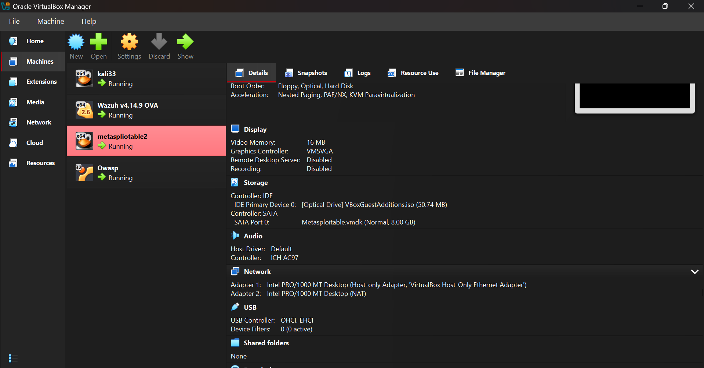
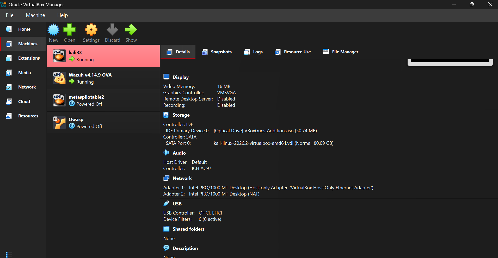
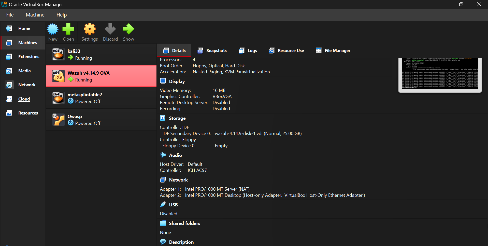
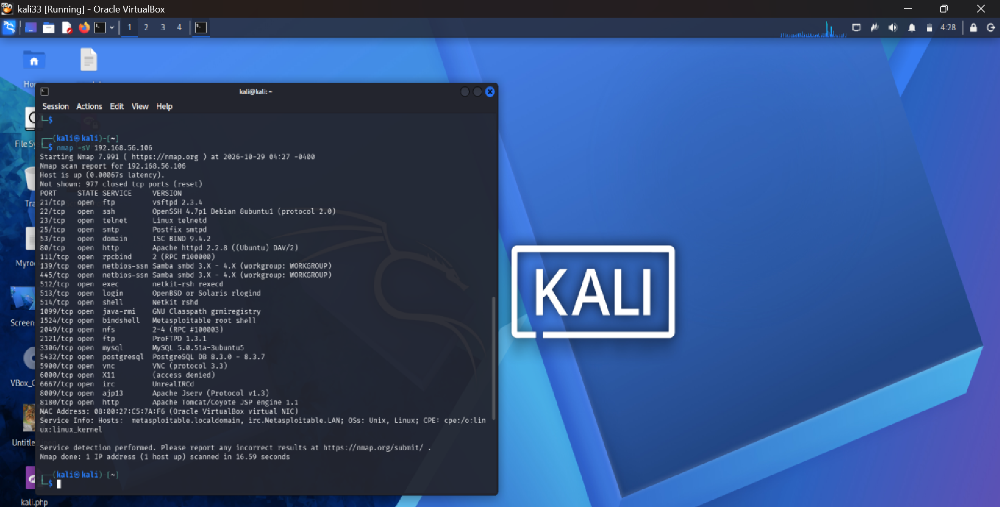
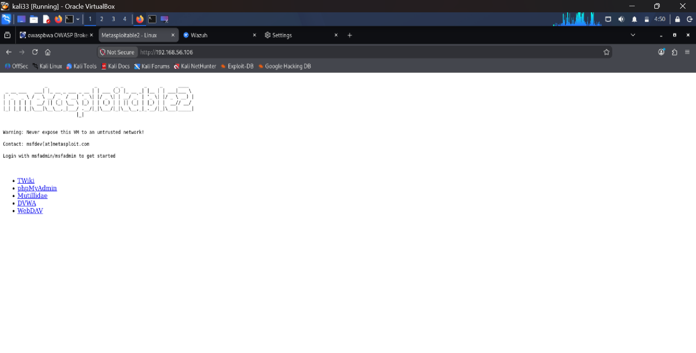
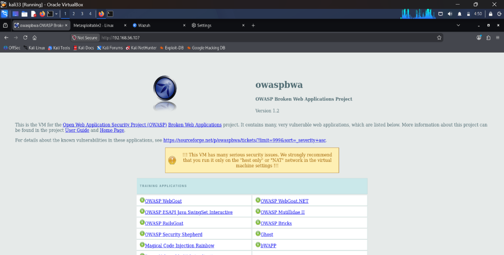
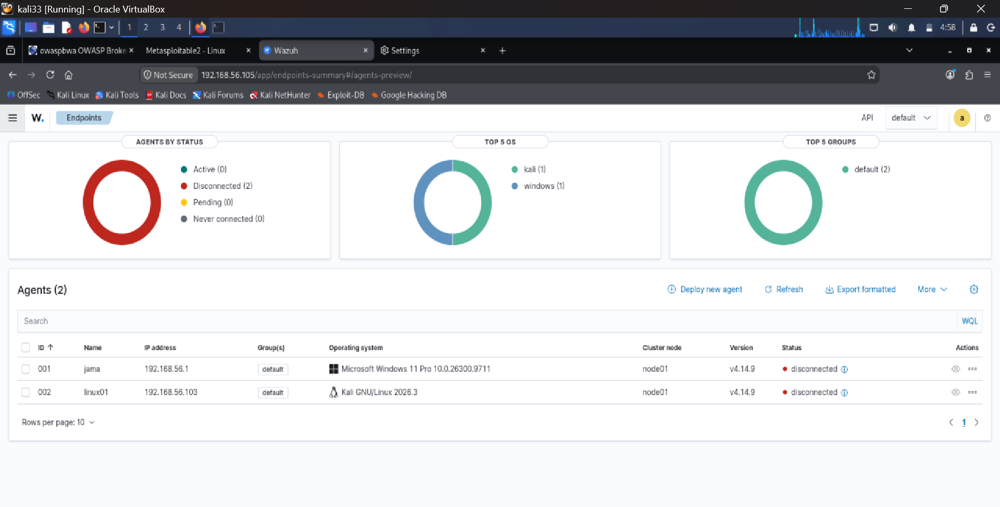
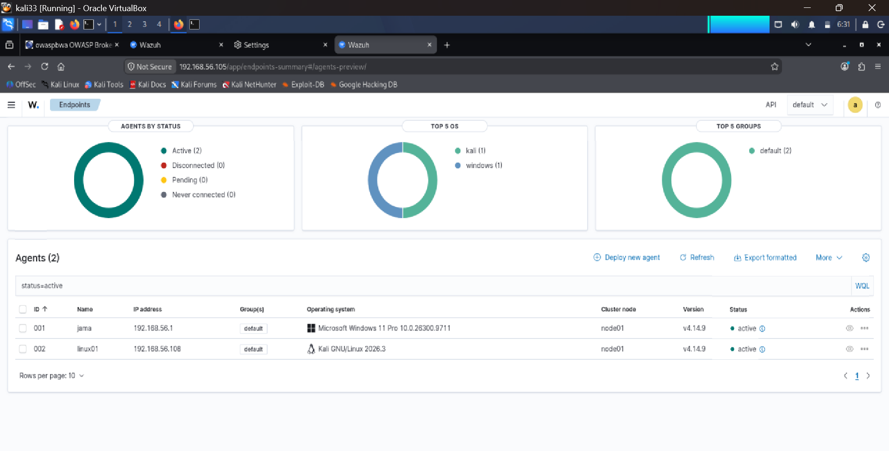
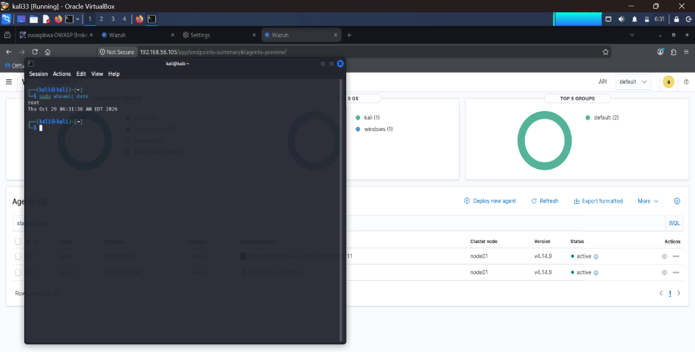

# Lab 01 - Isolated Cybersecurity Lab (Kali, Metasploitable 2, OWASP BWA, Wazuh)

**Date:** October 29, 2026
**Platform:** Oracle VirtualBox on a Windows 11 Pro host

## 1. Objective

Build a small, isolated environment with one attacker machine, two intentionally vulnerable targets and one monitoring platform. I use it to practice scanning and enumeration, to see how vulnerable services look to an attacker, and to watch monitored endpoints in a SIEM. That is the foundation for SOC analyst work.

## 2. Lab environment

| Machine | Role | Operating system / version | IP address |
|---|---|---|---|
| kali33 (hostname linux01 in Wazuh) | Attacker | Kali GNU/Linux 2026.3 | 192.168.56.108 |
| Wazuh v4.14.9 OVA | SIEM / defender | Wazuh manager and dashboard | 192.168.56.105 |
| metasploitable2 | Vulnerable target | Metasploitable 2 (Linux) | 192.168.56.106 |
| Owasp | Web target | OWASP Broken Web Apps v1.2 | 192.168.56.107 |
| Host PC | Host | Windows 11 Pro | 192.168.56.1 |

Addresses come from DHCP on the Host-Only network and can change between sessions (see section 7). The Kali address above is the one Wazuh reported at the final check.

## 3. Network design

All four VMs use a VirtualBox **Host-Only** adapter on `192.168.56.0/24`, so they can reach each other and the host. A second **NAT** adapter gives outbound internet access only. **No VM uses a Bridged adapter**, so none of the vulnerable machines can be reached from the home network or the internet.

| VM | Adapter 1 | Adapter 2 |
|---|---|---|
| kali33 | Host-Only | NAT |
| metasploitable2 | Host-Only | NAT |
| Owasp | Host-Only | NAT |
| Wazuh | NAT | Host-Only |

Evidence (VirtualBox Manager, network settings of each VM):

| | |
|---|---|
|  |  |
|  |  |

*The Kali and Wazuh screenshots were taken in a later session when the two targets were powered off. The VM is named `metaspliotable2` in VirtualBox (a typo in the VM name only).*

## 4. Connectivity test

From the Kali terminal I pinged the other machines on the Host-Only network. Every test returned 4 of 4 replies with 0% packet loss, which confirms the lab network works.


## 5. Service scan of Metasploitable 2

I ran an Nmap service-version scan from Kali against the Metasploitable 2 target:

```bash
nmap -sV 192.168.56.106
```

The scan finished in about 16.6 seconds and found **23 open TCP ports** (977 closed). The host was identified as `metasploitable.localdomain`.



Examples of what the scan reported, and why each matters to a defender:

| Port | Service / version | Why it matters |
|---|---|---|
| 21/tcp | FTP - vsftpd 2.3.4 | Old FTP version with a publicly known backdoor in that release |
| 2121/tcp | FTP - ProFTPD 1.3.1 | Second, outdated FTP service |
| 22/tcp | SSH - OpenSSH 4.7p1 | Very old SSH release |
| 23/tcp | Telnet | Remote login with no encryption, so credentials cross the network in clear text |
| 80/tcp | HTTP - Apache httpd 2.2.8 | Outdated web server hosting deliberately weak web apps |
| 139, 445/tcp | Samba smbd 3.X - 4.X | File-sharing service, a common target |
| 1524/tcp | bindshell ("Metasploitable root shell") | A service that hands out a root shell: should never exist on a real system |
| 3306/tcp, 5432/tcp | MySQL 5.0.51a, PostgreSQL 8.3.x | Databases exposed on the network |
| 6667/tcp | UnrealIRCd | IRC service; the build shipped on this target is a known-vulnerable one |
| 8180/tcp | Apache Tomcat / Coyote JSP engine 1.1 | Application server exposed |

These are old, outdated services, which is expected: Metasploitable 2 is deliberately vulnerable for training. **The scan was run only against my own lab machine.**

## 6. Web targets

Both web targets were opened in Firefox on Kali.




Metasploitable 2 serves TWiki, phpMyAdmin, Mutillidae, DVWA and WebDAV. OWASP Broken Web Apps v1.2 serves a larger set of training apps (WebGoat, Mutillidae II, bWAPP and others). Both pages warn against exposing these VMs to an untrusted network, which is why this lab uses an isolated Host-Only network.

## 7. Wazuh monitoring and troubleshooting

The Wazuh dashboard (`http://192.168.56.105`) lists two enrolled agents: the Windows 11 host and the Kali VM (`linux01`).

**Problem:** both agents showed **Disconnected (2)**.



**Investigation:**
1. The Wazuh dashboard still listed Kali at its old address (`192.168.56.103`), while Kali was now at `192.168.56.108`. DHCP had changed the addresses since the agents were enrolled.
2. The Kali agent configuration (`/var/ossec/etc/ossec.conf`) still pointed to `192.168.56.104`, an old address of the Wazuh manager. The manager was now at `192.168.56.105`.
3. A connectivity test to port 1514 on the correct manager address succeeded, so the network path was fine and the fault was the configuration.

**Fix:** correct the manager address in the agent configuration and restart the agent. After that, both agents became **Active (2), Disconnected (0)**.



Reference commands for this kind of fix (standard Wazuh agent procedure on Linux):

```bash
nc -zv <manager-ip> 1514                 # test the agent-to-manager port
sudo nano /var/ossec/etc/ossec.conf      # set <address> under <server> to the manager IP
sudo systemctl restart wazuh-agent       # restart the agent
```

## 8. Verification

The terminal output below shows the user, the system date and time, and the Wazuh dashboard with both agents active, taken in the same session.

```text
$ sudo whoami; date
root
Thu Oct 29 06:31:38 AM EDT 2026
```



## 9. What I learned

- Built a working four-machine lab on an isolated Host-Only network, with NAT used only for outbound internet access.
- Verified connectivity with ping and enumerated open services on a target with Nmap.
- Learned how Host-Only, NAT and Bridged networking differ, and why vulnerable machines must never be bridged.
- Diagnosed a real fault: Wazuh agents were disconnected because DHCP changed the manager IP. Checking the agent config, the connection to port 1514 and the manager address fixed it.

## 10. Improvements and next steps

- **Tighten the network:** the two vulnerable targets still have a NAT adapter, which allows outbound internet access. Best practice is Host-Only only for the targets, so I plan to remove their NAT adapters after setup.
- **Stop addresses changing:** use static or reserved addresses for the Wazuh manager so agents do not disconnect again.
- **Take VM snapshots** of a clean, working lab so I can restore it quickly.
- **Next lab:** run a controlled scan or login attempt from Kali against a monitored machine, find the resulting alerts in Wazuh, record the rule ID and severity, and map the activity to MITRE ATT&CK in an incident-style write-up.
