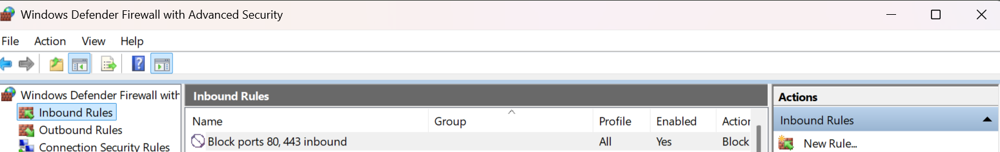
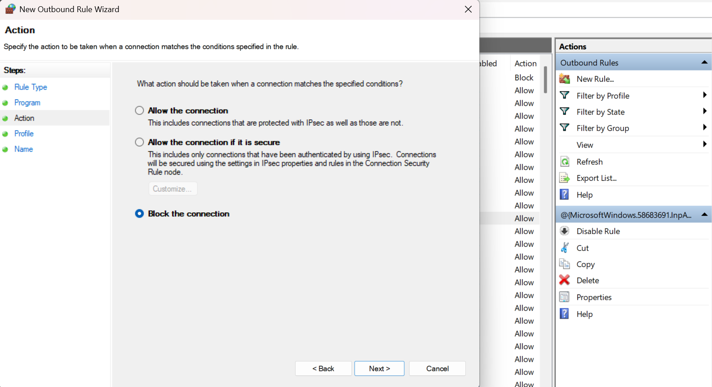
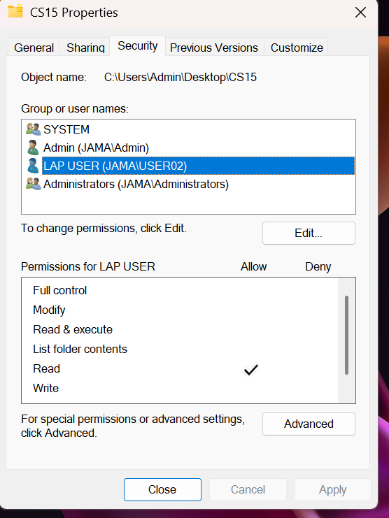
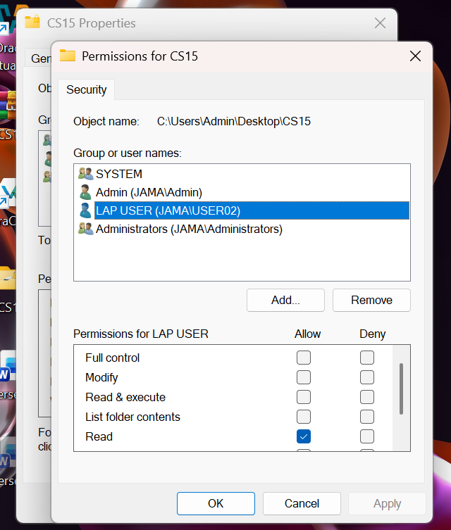
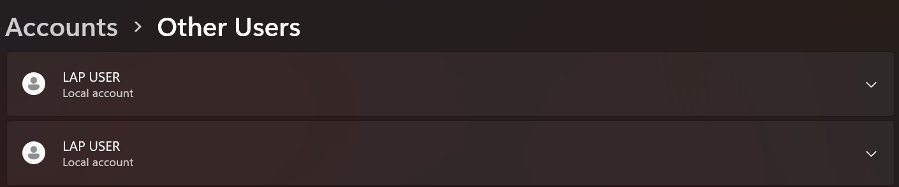
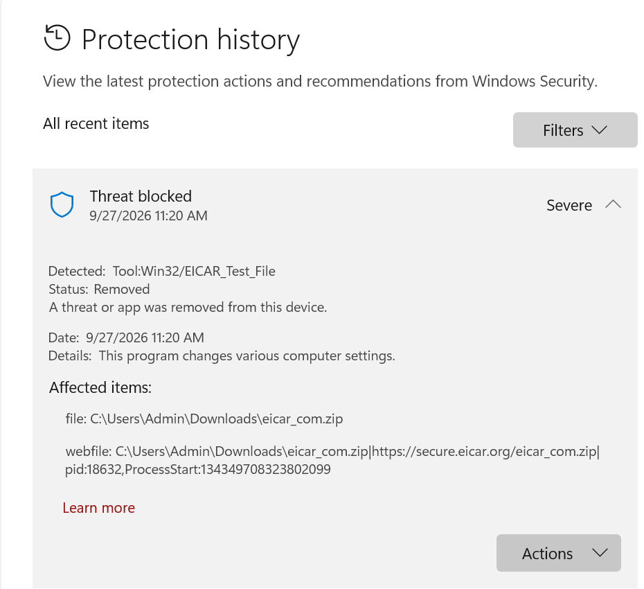
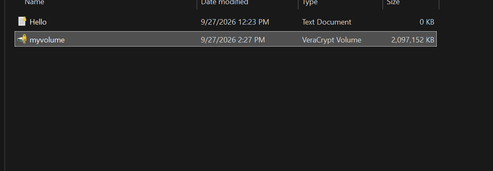
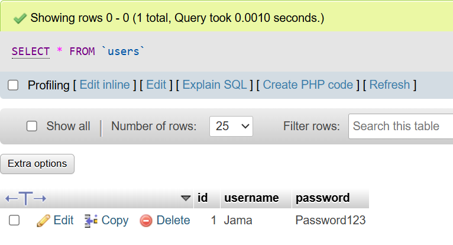
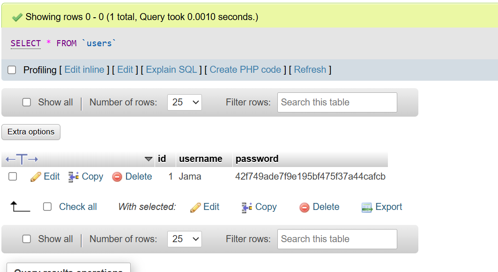

# Lab 02 - Windows Security Fundamentals

**Dates:** September 27 - October 5, 2026
**Platform:** Windows 11 Pro

A set of hands-on exercises covering the basic controls that protect a Windows system: a host firewall, least-privilege file permissions, antivirus detection, disk encryption and password hashing.

| Exercise | Control | Evidence |
|---|---|---|
| 1 | Windows Defender Firewall (inbound and outbound rules) | Screenshots 01, 02 |
| 2 | NTFS permissions and local user accounts | Screenshots 03, 04, 05 |
| 3 | Antivirus detection with the EICAR test file | Screenshot 06 |
| 4 | Disk encryption with VeraCrypt | Screenshot 07 |
| 5 | Password storage: plain text vs MD5 hash | Screenshots 08, 09 |
| 6 | Inspecting browser cookies and session storage | Described below, screenshots withheld |

---

## 1. Windows Defender Firewall

**Goal:** control which traffic can reach the machine and which programs can reach the network.

- **Inbound rule:** created a rule named *Block ports 80, 443 inbound*, applied to **all profiles**, **enabled**, with the action **Block**. This stops other machines from reaching a web server on this PC over HTTP or HTTPS.
- **Outbound rule:** used the *New Outbound Rule Wizard* (Rule Type, Program, Action, Profile, Name) to build a program-based rule and chose **Block the connection**.




**What I learned:** a firewall rule is defined by direction, program or port, profile (Domain, Private, Public) and action. Explicit **Block** rules take precedence over **Allow** rules, so a block rule can override an application's own allow rule. Rules should follow least privilege: only open what a service really needs.

*Only the rule I created is shown; the rest of my rule list is cropped out on purpose.*

## 2. File permissions and local users

**Goal:** give a different user the minimum access needed.

- Created local user accounts on the PC.
- On the folder `CS15`, opened **Properties > Security** and selected the user `LAP USER`.
- Gave that user **Read only**. Full control, Modify, Read & execute, List folder contents and Write are not granted.





**What I learned:** the **principle of least privilege**. A user who only needs to read files should not be able to change or delete them. This limits the damage from mistakes and from malware running under that account.

## 3. Antivirus detection (EICAR)

**Goal:** confirm that antivirus protection works, without using real malware.

I downloaded the **EICAR test file**, a harmless standard string that every antivirus product is designed to flag. Windows Security blocked it immediately:

- Threat blocked, severity **Severe**, on 9/27/2026 at 11:20 AM
- Detected as `Tool:Win32/EICAR_Test_File`
- Status: **Removed**, from my Downloads folder



**What I learned:** how to read a Windows Security *Protection history* entry (what was detected, when, where the file came from and what action was taken). That is the same kind of information a SOC analyst reads in an endpoint alert.

## 4. Disk encryption with VeraCrypt

**Goal:** protect data at rest.

I created an encrypted **VeraCrypt volume** named `myvolume`, about **2 GB** (2,097,152 KB). When it is dismounted, its contents are unreadable without the password.



**What I learned:** an encrypted container protects files if the laptop is lost or stolen. The password and key must be strong and kept safe, because there is no way to recover the data without them.

## 5. Password storage: plain text vs MD5 hash

**Goal:** see why passwords must never be stored in plain text.

In MySQL (via phpMyAdmin) I created a `users` table with a demo account. The password was a **throwaway demo value**, not a real password.

**Before** - the password is readable by anyone who can see the database:



I then hashed it with MySQL's built-in function:

```sql
UPDATE users SET password = MD5(password);
```

**After** - the stored value is a 32-character hash:



I double-checked the result outside the database with Python:

```python
import hashlib
print(hashlib.md5(b"Password123").hexdigest())
# 42f749ade7f9e195bf475f37a44cafcb   <- matches the value stored in the table
```

**What I learned:**
- A hash is one-way, so a database leak no longer exposes the password directly.
- **MD5 is not safe for real password storage.** It is very fast, and it has no salt, so the same password always gives the same hash. Attackers can crack common passwords with precomputed tables and fast guessing.
- Real systems should use a slow, salted password-hashing algorithm such as **bcrypt**, **scrypt** or **Argon2**.

## 6. Browser cookies and session storage (screenshots withheld)

I also used Chrome DevTools (Application tab) to inspect how a website stores **cookies** and **session storage**: cookie names, expiry, `Secure` and `HttpOnly` flags, and the values kept in session storage.

I did not publish these screenshots. Session cookies can sometimes be copied to take over a logged-in session, so showing live values would be a security risk. Keeping them out is part of how I handle evidence.

## Summary of skills shown

- Creating and reasoning about firewall rules (direction, profile, action)
- Applying least-privilege NTFS permissions to a local user
- Reading antivirus protection history and handling a detection
- Encrypting data at rest with VeraCrypt
- Explaining why password hashing matters and why MD5 is not enough
- Protecting sensitive evidence when documenting security work
